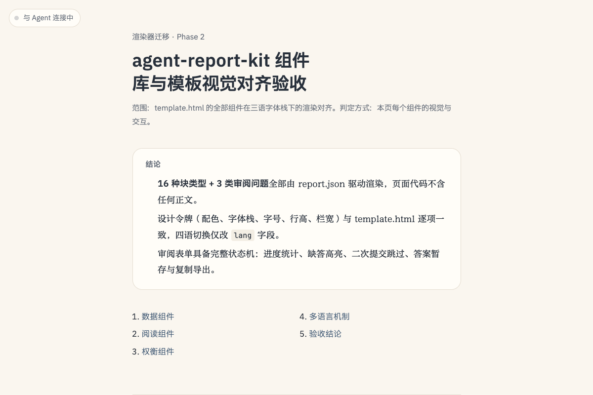

<div align="center">

# agent-report-kit

JSON in, one self-contained HTML report out — a renderer for AI agents that produce review and decision pages.

[](https://github.com/fang2hou/agent-report-kit/actions/workflows/check.yml)
[](./LICENSE)

</div>

The agent writes a `report.json`; this renderer compiles it into a single `index.html` that opens from `file://` with zero external assets, multilingual chrome, an optional review-question form, and a selection micro-Q&A. It is not a general site builder: one page, one finding, one decision.



## 🚀 Usage / Quick Start

**With an AI coding agent** — paste this into the agent to hand it the repository:

```text
Work in this repository. Read AGENTS.md at the repository root first and follow it.
```

The agent-report skill in [fang2hou/skills](https://github.com/fang2hou/skills) already drives this renderer end to end: it clones the repo, writes `report.json`, and runs the tools below.

**As a human** — requires [mise](https://mise.jdx.dev/) on macOS or Linux, plus Python 3.11+ for the answer-collection server. Runtime versions are pinned in `mise.toml`.

```bash
mise install && pnpm install
node tools/build.ts <report.json> out/index.html   # validate + compile + inject
python3 tools/serve.py start out/                  # serve it, collect answers
```

The compiled `index.html` runs anywhere — browser, `file://`, email attachment. `mise run` lists every other task (`check`, `dev`, `lint`, `typecheck`).

<details>
<summary>Authoring reference and the styleguide</summary>

- `docs/report-schema.md` — every field, block, and question type.
- `docs/components.md` — which component fits which content shape.
- `pnpm dev`, then open `/#/styleguide` — every component rendered live with token readouts.

</details>

## 💡 Concepts

- **Data, not markup** — the page is compiled from `report.json`; the renderer owns every style, component, and default string. Consumers never carry template content.
- **One self-contained file** — CSS, JS, and data are inlined; the page opens offline and stays small.
- **The round trip** — a served page writes review answers to `state.json` and selection questions to `chat.json`, so the agent reads decisions instead of asking the user to paste them.
- **Reader's language** — `lang` (`zh-CN`, `ja`, `en`) switches fonts, metrics, and every chrome string.

## ✨ Features

- **14 content blocks** — paragraphs, lists, tables, bars, comparisons, translated quote pairs, figures, collapsible evidence — picked by content shape, not by styling taste.
- **Review questions** — single choice, verdict lists, and free text; localStorage draft, progress count, one submit.
- **Selection micro-Q&A** — highlight any passage and ask about it; the question anchors to the text and the reply lands inline.
- **Verified output** — the zod schema validates at build time; the whole pipeline runs from any cwd.

## 📚 Learn More

| Goal                  | Read                                             |
| --------------------- | ------------------------------------------------ |
| Author a report       | [docs/report-schema.md](./docs/report-schema.md) |
| Understand the system | [ARCHITECTURE.md](./ARCHITECTURE.md)             |
| Develop and validate  | [DEVELOPMENT.md](./DEVELOPMENT.md)               |
| Contribute a change   | [CONTRIBUTING.md](./CONTRIBUTING.md)             |
| Give it to an agent   | [AGENTS.md](./AGENTS.md)                         |

## 📄 License

MIT — see [LICENSE](./LICENSE).
